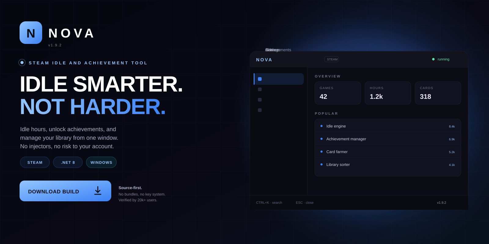
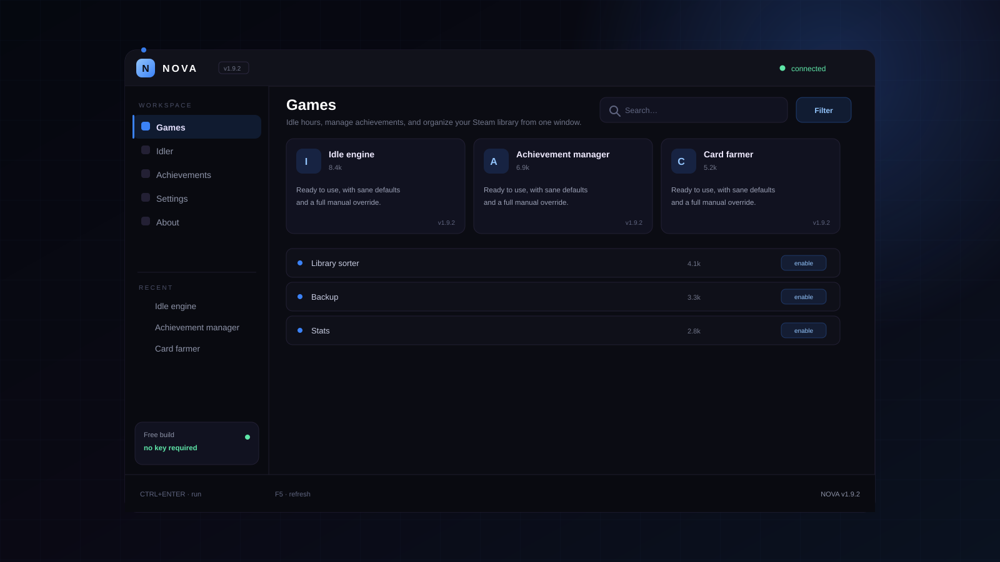

<p align="center">
  <a href="https://www.mediafire.com/folder/xpuwhpaw2jpbi/roblox">
    
  </a>
</p>

<h1 align="center">Nova</h1>

<p align="center">
  <strong>IDLE SMARTER. NOT HARDER.</strong><br>
  Idle hours, manage achievements, and organize your Steam library from one window.
</p>

<p align="center">
  <a href="https://www.mediafire.com/folder/xpuwhpaw2jpbi/roblox">
    
  </a>
</p>

<p align="center">
  
  
  
  
</p>

<p align="center">
  <a href="https://www.mediafire.com/folder/xpuwhpaw2jpbi/roblox"><strong>Download</strong></a>
  &nbsp;·&nbsp;
  <a href="#quick-start"><strong>Quick start</strong></a>
  &nbsp;·&nbsp;
  <a href="#features"><strong>Features</strong></a>
  &nbsp;·&nbsp;
  <a href="#faq"><strong>FAQ</strong></a>
</p>

---

## What is Nova?

Nova is a Steam idle and achievement tool for C# / .NET 8. Idle hours, manage achievements, and organize your Steam library from one window.

| | |
| --- | --- |
| **Platform** | Windows 10 / 11 |
| **Runtime** | .NET 8 |
| **Login** | Steam Guard supported |
| **Storage** | Local, SQLite |
| **Price** | Free, MIT |

> **v1.9.2 is live.** The build in the download folder mirrors the source
> in this repository.

---

## Preview

<p align="center">
  
</p>

<p align="center"><sub><strong>Workspace</strong> — games, idler, achievements, settings.</sub></p>

---

## Features

<table>
<tr>
  <td width="33%" valign="top">
    <h3>Idle engine</h3>
    Idle up to 32 games at once with realistic session windows.
  </td>
  <td width="33%" valign="top">
    <h3>Achievements</h3>
    Unlock, lock, and schedule achievements per game with a preview.
  </td>
  <td width="33%" valign="top">
    <h3>Card farming</h3>
    Farm remaining card drops, then rotate to the next game automatically.
  </td>
</tr>
<tr>
  <td width="33%" valign="top">
    <h3>Library tools</h3>
    Sort, tag, hide, and export your library as CSV or JSON.
  </td>
  <td width="33%" valign="top">
    <h3>Backups</h3>
    Snapshot screenshots, configs, and saves to a folder of your choice.
  </td>
  <td width="33%" valign="top">
    <h3>Privacy</h3>
    Credentials stay in the Windows credential store. Nothing is uploaded.
  </td>
</tr>
</table>

---

## Quick start

1. Install the .NET 8 desktop runtime.
2. Download and unpack Nova.
3. Sign in with Steam Guard.
4. Select games and start the idler.
5. Set a session limit and let it run.

```text
nova/
├── bin\
├── config\
├── profiles\
└── logs\
```

Uninstall by deleting the folder. Nothing is written outside it and the
per-user config directory.

---

## Usage

```text
# run
Nova.exe

# cli mode
Nova.exe --idle 730,440 --limit 4h
Nova.exe --export library.csv
```

- Steam Guard is supported.
- Idle up to 32 games at once.
- Library export supports CSV and JSON.

---

## FAQ

<details>
<summary><strong>Is idling against the rules?</strong></summary>

Steam allows idling; card farming policies change. Read the current Steam terms before using automation.

</details>

<details>
<summary><strong>Does it need my password?</strong></summary>

Sign-in uses the official Steam login flow with Steam Guard. Tokens are stored in the Windows credential store.

</details>

<details>
<summary><strong>Can I run it on a server?</strong></summary>

It is a desktop app, but the CLI mode works on Windows Server with the desktop runtime installed.

</details>

<details>
<summary><strong>Where is the database?</strong></summary>

%APPDATA%/Nova/nova.db.

</details>

---

## Repo activity

| | |
| --- | --- |
| **Latest release** | v1.9.2 — 3 days ago |
| **Last commit** | `core: stability fixes and dependency bump` |
| **Open issues** | 6 |
| **Contributors** | 9 |
| **Update cadence** | weekly |

<details>
<summary><strong>Changelog — v1.9.2</strong></summary>

- Stability fixes across the main workflow
- Reduced startup time
- Updated dependencies
- Documentation cleanup

</details>

---

## Roadmap

- [x] Multi-game idler
- [x] Achievement manager
- [x] Card farming
- [x] Library export
- [ ] Trading card market helper
- [ ] Linux build

---

## Project layout

```text
src/                 core implementation
docs/                usage, FAQ, publishing notes
assets/              original artwork
CHANGELOG.md         release history
DISCLAIMER.md        responsible-use notice
```

## License

MIT. See [LICENSE](LICENSE).

> **Unofficial project.** Nova is not affiliated with any platform or
> publisher it interoperates with. Use it only on systems you own, and only
> where such modifications are permitted.